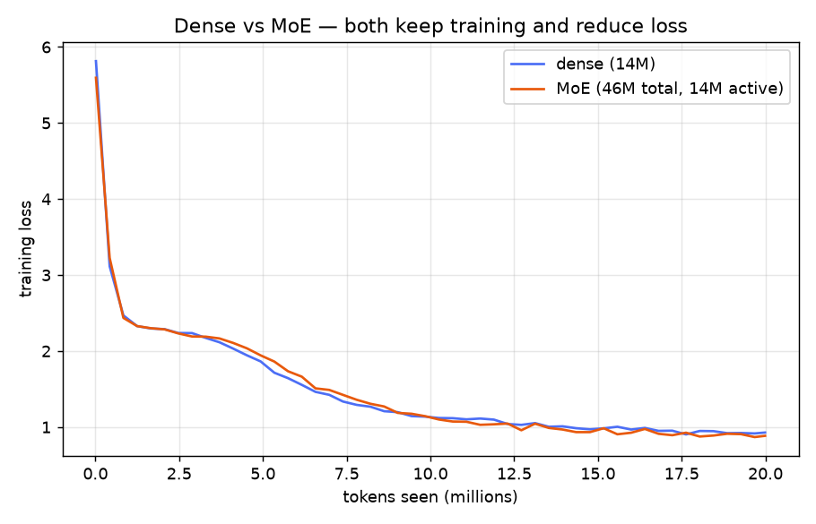
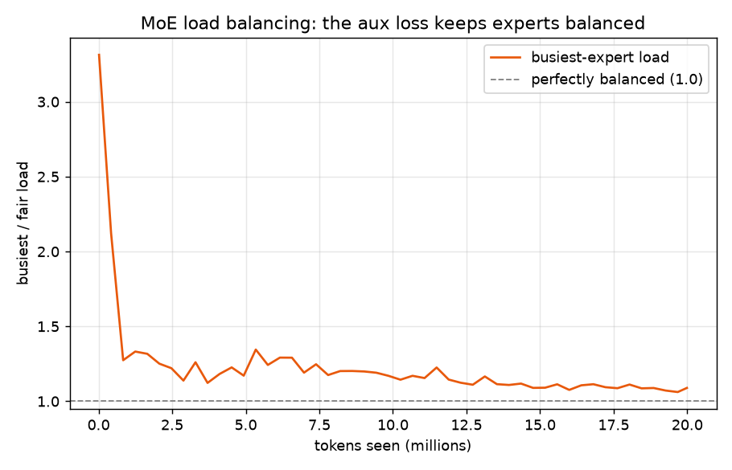
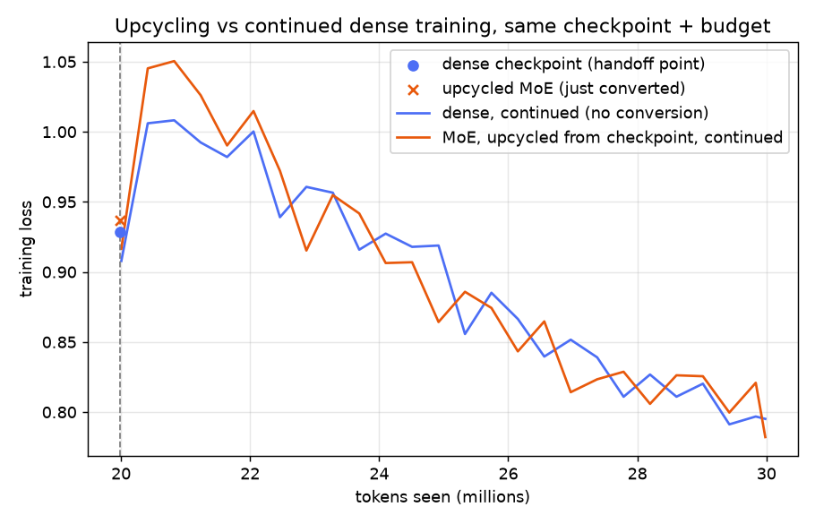

# Mixture-of-Experts — converting a dense feed-forward into a router + experts

**ERA V5 · Session 14 (Mixture-of-Experts)** · Apple M3 Max (MPS), no CUDA.

> Train a "linear"/dense model and convert it into a Mixture-of-Experts. Your call on
> model size and data — but show that **both keep training and reduce loss**.

A Mixture-of-Experts layer keeps attention unchanged and replaces the one dense
feed-forward network with a **router + N experts**: for each token the router scores
every expert, keeps the **top-k**, and sums those experts' outputs weighted by the
router. That raises total capacity while keeping the compute per token small. This repo
starts from a small dense Transformer LM, converts its SwiGLU FFN into an MoE layer
(8 experts, top-2), and trains both on byte-level TinyStories.

📎 **Repo:** https://github.com/SomaKorada07/ERA_V5/tree/main/MixtureOfExperts

---

## TL;DR results

| model | total params | active / token | final val loss | speed |
|---|---:|---:|---:|---:|
| dense (SwiGLU FFN) | 14.5M | 14.5M | **0.931** | 24,029 tok/s |
| MoE (8 experts, top-2), from scratch | 46.3M | 14.5M | **0.890** | 17,314 tok/s |

Both models train and reduce loss. The MoE holds **~3× the parameters** of the dense
model at the **same active compute per token** (top-2 of 8 experts, each expert half the
dense width), its routing stays balanced throughout training, and it reaches a **lower
validation loss (0.890 vs 0.931)**.




On top of training both from scratch, the repo also runs the actual conversion the
assignment asks for — **Expert-Upcycling**: take the *trained* dense checkpoint, copy its
SwiGLU feed-forward into every expert, verify the conversion preserved what the dense
model learned, then continue training two matched branches from that checkpoint for an
equal extra budget (10M tokens): keep training the dense model (`dense_continued`) vs.
convert it to MoE and keep training that (`moe_upcycled`).

| branch | checkpoint val loss | after +10M tokens | total / active params |
|---|---:|---:|---:|
| dense checkpoint (handoff point, 20M tokens) | 0.929 | — | 14.5M / 14.5M |
| upcycled MoE (just converted, no training yet) | 0.937 | — | 88.8M / 25.1M |
| dense, continued | — | **0.817** | 14.5M / 14.5M |
| MoE, upcycled, continued | — | **0.799** | 88.8M / 25.1M |

The conversion works as intended: the freshly-upcycled MoE's val loss (0.937) sits right
next to the dense checkpoint's (0.929) — far below a random-init MoE of the same shape
(5.637, i.e. ~ln(256), chance level for the byte vocab) — so the copy actually transferred
what the dense model learned instead of discarding it. After the same extra 10M-token
budget, the upcycled-and-continued MoE **beats continuing the dense model** (0.799 vs
0.817), which matches the result the sparse-upcycling literature reports (Google, 2022):
converting beats continuing the standard model, within a compute budget well short of
training the larger model from scratch.



---

## What "converting to MoE" means here

The two models are identical except for the feed-forward block:

**Dense** — one SwiGLU network per layer:
```
E(x) = W_down( SiLU(W_gate x) ⊙ W_up x )
```

**MoE** — a router picks the top-k of N experts and sums their outputs:
```
scores  = softmax(router · x)         # one score per expert
T       = indices of the top-k scores # k experts kept
g_i     = scores_i / Σ_{j∈T} scores_j # renormalised router weights
y       = Σ_{i∈T} g_i · E_i(x)        # weighted sum of the chosen experts
```
Each `E_i` is its own SwiGLU network. With **8 experts, top-2**, and each expert half
the dense hidden width, the **active** parameters per token equal the dense model while
the **total** parameter count is much larger — the whole point of MoE.

### Load balancing

Left alone the router collapses onto a few favourite experts. We add the Switch-style
auxiliary loss from the notes:
```
L_aux = α · N · Σ_i f_i · P_i          (α = 0.01, N = number of experts)
```
where `f_i` is the fraction of tokens routed to expert `i` (no gradient — top-k is a
step) and `P_i` is its mean router probability (has gradient). Minimising `f·P` lowers
the probability of busy experts and raises it for idle ones. In training the busiest-
expert load falls from ~3.3× a fair share toward **1.0**, with **no dead experts**.

### Sparse dispatch (and an MPS caveat)

The MoE dispatches each token only to its top-k experts (`routing="sparse"`), so the
per-token compute matches the dense FFN. We verify this equals the simple
"compute every expert then mask" reference to ~1e-7. On MPS, sparse dispatch uses
dynamic per-expert shapes that the backend recompiles each step, so its **wall-clock
does not beat the dense model on this Mac** — the FLOP / active-parameter savings are
real and would show on a CUDA GPU. A fixed-shape `routing="masked"` path is included for
comparison.

### Expert-Upcycling: converting a *trained* dense checkpoint

The from-scratch comparison above answers "can an MoE train?". The upcycling experiment
answers the question the assignment actually poses — "train a dense model and *convert*
it" — by reusing what the dense model already learned instead of starting the MoE from
random weights:

1. **Checkpoint handoff** — `moe.engine._upcycle` copies every shared weight (attention,
   norms, embeddings) from the trained dense model into a same-shaped MoE model, then
   copies the dense SwiGLU feed-forward **whole** into every expert. This only lines up
   dimensionally if each expert matches the dense `d_ff` (so `expert_width=1536` here,
   not the narrower `768` used for the from-scratch active-compute-matched comparison
   above — a genuine upcycled expert is a full copy, which is why its active params end
   up higher than the dense model's, 25.1M vs 14.5M).
2. **Verify the conversion loss** — immediately after the copy (before any MoE-specific
   training) we evaluate the upcycled model's val loss and check it sits next to the
   dense checkpoint's, not at the random-init MoE's loss. Result: 0.929 (dense) → 0.937
   (upcycled) vs 5.637 (random-init MoE, ≈ ln(256), chance level) — the conversion
   transferred the learned function.
3. **Continue matched branches** — from that same checkpoint, `dense_continued` (keep
   training the dense model) and `moe_upcycled` (the converted model) each get the same
   extra 10M-token budget. The upcycled-and-continued MoE reaches a lower loss (0.799 vs
   0.817), matching the sparse-upcycling result from the literature: converting beats
   continuing to train the standard model, for a budget well short of training the larger
   model from scratch.

---

## Model & setup

| | |
|---|---|
| architecture | 6-layer GPT, width 384, 6 heads, context 512 |
| feed-forward | dense SwiGLU (hidden 1536) → MoE (8 experts × width 768, top-2, from scratch) |
| upcycled MoE feed-forward | 8 experts × width 1536 (full dense-FFN copies), top-2 |
| vocab | 256 (byte-level UTF-8) |
| data | TinyStories, 40M bytes train / 2M val |
| optimizer | AdamW, cosine LR + warmup, grad-clip 1.0 |
| token budget | 20,000,000 per from-scratch model; +10,000,000 per continued branch |
| device | Apple M3 Max, MPS backend, `torch` 2.13 |

---

## Repository layout

```
MixtureOfExperts/
├── moe/
│   ├── model.py        # GPT with dense OR MoE feed-forward; router; SwiGLU experts; aux loss
│   ├── data.py         # TinyStories -> raw UTF-8 byte token bins
│   └── engine.py       # training loop, loss/throughput logging, routing stats, upcycling
├── notebooks/
│   ├── 01_dense_baseline.ipynb     # the dense "linear" model
│   ├── 02_moe_layer.ipynb          # convert FFN -> router+experts, balancing, sparse check
│   └── 03_comparison_report.ipynb  # dense vs MoE, final report
├── run_experiments.py  # trains dense + MoE from scratch, then runs the upcycle experiment
├── build_notebooks.py  # regenerates the notebooks
└── results/            # *.json metrics + figures (+ dense_checkpoint.pt, gitignored)
```

## Reproduce

```bash
pip install torch datasets numpy matplotlib nbformat nbconvert
python -c "from moe.data import prepare; prepare()"   # cache TinyStories bytes
python run_experiments.py                             # dense + MoE from scratch, then upcycle, make figures
```

---

## Findings

1. **Both keep training and reduce loss** — the dense model and the from-scratch MoE
   model both drive training loss down smoothly on TinyStories (val 0.931 and 0.890).
2. **More capacity at equal active compute — and lower loss.** The MoE has ~3× the total
   parameters of the dense model but the same active parameters per token, and it reached
   a **lower validation loss (0.890 vs 0.931)** — the extra capacity pays off exactly as
   MoE promises.
3. **Routing stays balanced** — the auxiliary loss pushes the busiest-expert load from
   ~3.3× toward **1.07** (1.0 = perfect) with no dead experts, so every expert learns.
4. **Sparse routing is exact** — dispatching only the chosen experts matches the
   compute-all reference to ~1e-7.
5. **MPS caveat** — sparse dispatch's dynamic shapes are recompiled by MPS, so the
   compute saving doesn't translate to wall-clock on this Mac; it would on CUDA.
6. **Converting a trained dense checkpoint works** — copying the dense SwiGLU into every
   expert carries the dense model's loss across the conversion (0.929 → 0.937), nowhere
   near a random-init MoE (5.637 ≈ ln(256), chance level) — so Expert-Upcycling actually
   reuses what the dense model learned.
7. **Upcycling beats continuing the dense model** — given the same extra 10M-token
   budget from the same checkpoint, the upcycled-and-continued MoE reaches a lower loss
   than just continuing the dense model (0.799 vs 0.817), matching the headline result of
   the sparse-upcycling literature at this small scale.
